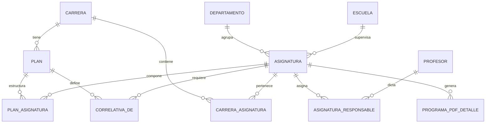
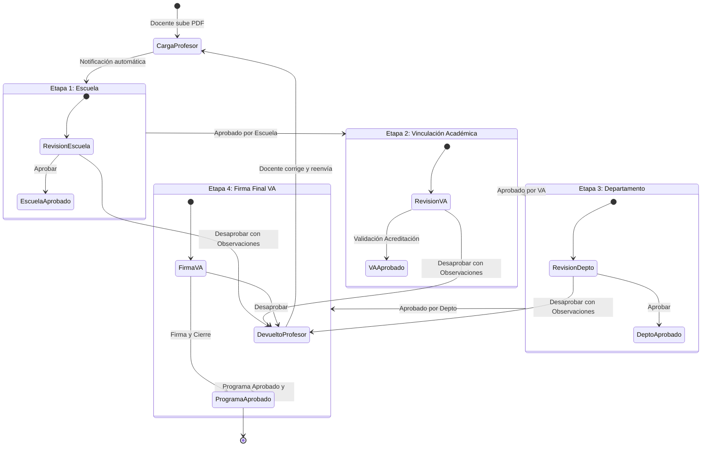

# 📘 DOCUMENTACIÓN TÉCNICA - SISTEMA VASPA
### *Validación y Aprobación Secuencial de Programas Analíticos*
**Universidad Nacional de la Patagonia Austral (UNPA)**

---

## 📑 Tabla de Contenidos
1. [Introducción](#1-introducción)
2. [Descripción General del Sistema](#2-descripción-general-del-sistema)
3. [Arquitectura del Software](#3-arquitectura-del-software)
4. [Tecnologías Utilizadas](#4-tecnologías-utilizadas)
5. [Estructura del Proyecto](#5-estructura-del-proyecto)
6. [Base de Datos](#6-base-de-datos)
7. [Roles y Permisos (RBAC)](#7-roles-y-permisos-rbac)
8. [Circuito de Programas Analíticos](#8-circuito-de-programas-analíticos)
9. [Principales Funcionalidades](#9-principales-funcionalidades)
10. [Gestión de Documentos PDF](#10-gestión-de-documentos-pdf)
11. [Sistema de Notificaciones por Correo](#11-sistema-de-notificaciones-por-correo)
12. [Configuración del Sistema](#12-configuración-del-sistema)
13. [Instalación y Despliegue](#13-instalación-y-despliegue)
14. [Mantenimiento y Resolución de Problemas](#14-mantenimiento-y-resolución-de-problemas)
15. [Estrategia de Pruebas](#15-estrategia-de-pruebas)
16. [Historial de Cambios](#16-historial-de-cambios)

---

## 1. Introducción
El presente documento constituye la **Documentación Técnica Integral** del sistema **VASPA** (*Validación y Aprobación Secuencial de Programas Analíticos*). Su propósito es servir como guía de referencia técnica y arquitectónica para desarrolladores, administradores de sistemas y personal de soporte técnico encargados del mantenimiento, evolución y despliegue de la plataforma.

---

## 2. Descripción General del Sistema
**VASPA** es una plataforma web desarrollada para informatizar, centralizar, agilizar y auditar el flujo de presentación, revisión, validación académica, aprobación departamental y archivo de los programas analíticos de las asignaturas pertenecientes a las diversas carreras y planes de estudio universitarios.

### Objetivos Principales:
- **Estandarización del Circuito:** Implementar un circuito secuencial transparente de revisión y aprobación con trazabilidad completa.
- **Control de Vigencias:** Monitorear el vencimiento de los programas vigentes (validez académica trienal).
- **Flexibilidad Curricular:** Administrar carreras, planes de estudio con sus respectivas materias y reglas de correlatividad.
- **Auditoría e Inteligencia Gerencial:** Proveer paneles de control (KPIs, estadísticas de avance, alarmas de retraso y reportes exportables en Excel y PDF).

---

## 3. Arquitectura del Software
VASPA implementa una **Arquitectura en Tres Capas** con separación de responsabilidades basada en el patrón Modelo-Vista-Controlador (MVC adaptado a PHP):

```
┌─────────────────────────────────────────────────────────────┐
│                 CAPA DE PRESENTACIÓN (VISTA)                │
│  - Vistas PHP / HTML5 / CSS3 / Bootstrap 4                  │
│  - DataTables, SelectPicker, Lucide Icons, Chart.js         │
└──────────────────────────────┬──────────────────────────────┘
                               │  Peticiones AJAX / Form POST
                               ▼
┌─────────────────────────────────────────────────────────────┐
│                 CAPA DE CONTROL Y SERVICIOS                 │
│  - Controladores: /controlSistema/                          │
│  - Endpoints AJAX: /lib/consultaAjax/                       │
│  - Control de Acceso y Seguridad: /lib/ControlAcceso.Class  │
└──────────────────────────────┬──────────────────────────────┘
                               │  Invocación de Objetos y Métodos
                               ▼
┌─────────────────────────────────────────────────────────────┐
│                  CAPA DE MODELO Y DATOS                     │
│  - Clases del Dominio: /modeloSistema/ (Carrera, Plan, etc) │
│  - Gestor de Conexión Singleton: BDConexionSistema.Class    │
│  - Persistencia: MySQL / MariaDB Relacional                 │
└─────────────────────────────────────────────────────────────┘
```

### Principios de Diseño:
- **Control de Acceso Centralizado:** Validación de sesión y permisos granulares al inicio de cada script.
- **Interacción Dinámica (SPA-like):** Carga y actualización de tablas y formularios mediante AJAX sin recargas completas de pantalla.
- **Patrón Singleton:** Gestión eficiente de conexiones a la base de datos a través de `BDConexionSistema::getInstancia()`.

---

## 4. Tecnologías Utilizadas

| Componente | Tecnología | Versión / Detalle |
| :--- | :--- | :--- |
| **Lenguaje Backend** | PHP | 7.4 / 8.x (POO, extensiones `mysqli`, `mbstring`, `openssl`) |
| **Base de Datos** | MySQL / MariaDB | 5.7+ / 10.4+ |
| **Servidor Web** | Apache | Compatible con XAMPP / WampServer / LAMP stack |
| **Frontend Framework** | Bootstrap | 4.1.3 + Estilos personalizados |
| **Librería JS Base** | jQuery | 3.3.1 |
| **Tablas Dinámicas** | DataTables | 1.10+ (Con soporte Buttons: Excel y PDF) |
| **Selects Mejorados** | Bootstrap Select | 1.13.8 (Live Search, Data Container) |
| **Iconografía** | Lucide Icons / Open Iconic | SVG embebido e íconos vectoriales |
| **Visualización PDF** | Visor Nativo / PDF.js | Embebido en modales y pestañas seguras |
| **Mailing** | PHPMailer / Mail PHP | Notificaciones automáticas HTML vía SMTP |

---

## 5. Estructura del Proyecto

```
vaspa/
├── app/                        # Módulos de administración de usuarios y seguridad
│   ├── login.php               # Inicio de sesión
│   ├── salir.php               # Cierre de sesión y destrucción de cookies
│   ├── usuarios.php            # ABM de usuarios del sistema
│   ├── roles.php               # Asignación de roles
│   └── permisos.php            # Definición de permisos
├── controlSistema/             # Controladores de lógica de negocio y acciones directas
│   ├── ManejadorPlan.php       # Gestión y clonación de planes de estudio
│   ├── ManejadorCarrera.php    # Gestión de carreras
│   ├── programa.avanzar.circuito.php # Aprobación secuencial en el circuito
│   ├── programa.desaprobar.php # Devolución de programa con observaciones
│   ├── programa.vacancia.php   # Switch de vacancia de escuela
│   └── programa.habilitar.reentrega.php # Reseteo de entrega para reenvío
├── gui/                        # Componentes comunes de la interfaz de usuario
│   ├── navbar.php              # Menú de navegación dinámico según permisos
│   └── footer.php              # Pie de página y scripts compartidos
├── lib/                        # Librerías de soporte, assets y endpoints AJAX
│   ├── ControlAcceso.Class.php # Control de permisos y sesión (RBAC)
│   ├── Constantes.Class.php    # Constantes globales del sistema
│   ├── bootstrap-4.1.1-dist/   # Framework CSS/JS Bootstrap
│   ├── datatable/              # Scripts y estilos de DataTables
│   ├── consultaAjax/           # Endpoints asíncronos divididos por módulo
│   │   ├── revisarPrograma/    # AJAX para revisión y visor de programas
│   │   ├── planAsignatura/     # AJAX para materias de planes y creación al vuelo
│   │   ├── asignaturaCorrelativa/ # AJAX para gestión de correlatividades
│   │   ├── carrerasMaterias/   # AJAX para gestión de materias por carrera
│   │   ├── informeGerencial/   # AJAX para dashboard y reportes de 5 años
│   │   └── vigenciaProgramas/  # AJAX para vigencias de programas
│   └── notificacionesMail/     # Scripts de envío de correo SMTP
├── modelo/                     # Clases abstractas genéricas de persistencia
│   └── BDColeccionGenerica.Class.php
├── modeloSistema/              # Clases de dominio del negocio
│   ├── BDConexionSistema.Class.php # Singleton de conexión a BD
│   ├── Asignatura.Class.php    # Entidad Asignatura
│   ├── Carrera.Class.php       # Entidad Carrera
│   ├── Plan.Class.php          # Entidad Plan de Estudio
│   ├── Profesor.Class.php      # Entidad Docente
│   ├── ProgramaPDFDetalle.Class.php # Entidad y máquina de estados del Circuito
│   ├── Departamento.Class.php  # Entidad Departamento
│   └── Escuela.Class.php       # Entidad Escuela
├── uploads/                    # Almacenamiento de archivos PDF subidos
└── vista/                      # Vistas principales del sistema
    ├── inicio.php              # Panel de bienvenida
    ├── panelVA.php             # Panel de Vigencias (Vinculación Académica)
    ├── revisar.programas.php   # Bandeja de revisión secuencial de programas
    ├── monitoreo.circuito.php  # Tablero de control de monitoreo de circuito
    ├── informeGerencial.programas.php # Dashboard gerencial e historial
    ├── carreras.php            # ABM de Carreras
    ├── carreras.materias.php   # Gestión de materias y asignación por plan
    ├── planes.php              # Listado y administración de planes
    ├── plan.crear.php          # Asistente de creación y clonación de planes
    ├── plan.asignaturas.php    # Editor de asignaturas de un plan
    ├── asignaturas.correlativas.php # Matriz de correlatividades
    └── profesores.php          # ABM de Docentes
```

---

## 6. Base de Datos

### Diagrama Entidad-Relación Conceptual:


### Tablas Principales:
1. **`carrera`**: Define las carreras universitarias (`id`, `nombre`, `idDirector`, etc.).
2. **`plan`**: Planes de estudio asociados a una carrera (`id`, `idCarrera`, `anio_inicio`, `anio_fin`).
3. **`asignatura`**: Materias dictadas (`id`, `nombre`, `idDepartamento`, `idEscuela`, `es_institucional`).
4. **`carrera_asignatura`**: Vínculo entre carreras y materias con bandera de actividad (`idCarrera`, `idAsignatura`, `activo`).
5. **`plan_asignatura`**: Asignaturas asociadas a un plan específico (`idPlan`, `idAsignatura`, `tieneCorrelativa`).
6. **`correlativa_de`**: Reglas de correlatividad (`id`, `requisito`, `idAsignatura`, `idAsignatura_Correlativa_Anterior`, `idPlan`).
7. **`profesor`**: Docentes del cuerpo académico (`id`, `nombre`, `apellido`, `email`, `telefono`).
8. **`asignatura_responsable`**: Asignación de profesores responsables a cada materia (`idAsignatura`, `idProfesor`).
9. **`programa_pdf_detalle`**: Historial y estado del circuito de cada programa (`id`, `id_asignatura`, `anio`, `ruta_archivo`, `en_revision`, `aprobado_escuela`, `aprobado_va`, `aprobado_depto`, `aprobado_va_firma`, `fue_desaprobado`, `comentario_desaprobacion`, `fecha_ultimo_movimiento_circuito`, `fecha_carga`).
10. **`configuracion_sistema`**: Parámetros globales clave-valor (`vacancia_escuela`, `asignaturas_ocultas_panel_va`).

---

## 7. Roles y Permisos (RBAC)

El sistema implementa un control de acceso basado en roles definido en [`lib/ControlAcceso.Class.php`](file:///c:/xampp/htdocs/vaspa/lib/ControlAcceso.Class.php):

| Rol | Descripción | Permisos Principales |
| :--- | :--- | :--- |
| **Administrador** | Control total de la plataforma | Acceso irrestricto a todos los módulos y configuraciones |
| **Vinculación Académica** | Gestión académica, acreditación y archivo | Monitoreo, Vigencias, Informe Gerencial, Validación y Firma de Programas, ABM Carreras/Planes |
| **Director de Escuela** | Validación de programas de su escuela | Revisión y Aprobación de programas en Etapa 1 |
| **Director de Departamento**| Validación disciplinar | Revisión y Aprobación de programas en Etapa 3 |
| **Profesor** | Responsable de cátedra | Carga de programas analíticos PDF y consulta de sus asignaturas |

---

## 8. Circuito de Programas Analíticos

El circuito de aprobación sigue una máquina de estados secuencial auditada:



### Casos Especiales del Circuito:
1. **Vacancia de Escuela:** Si la configuración `vacancia_escuela = 1` está activa, los programas saltan automáticamente la Etapa 1 y van directo a Vinculación Académica.
2. **Materias Institucionales:** Asignaturas transversales (`es_institucional = 1`) omiten la revisión de Escuela.
3. **Reentrega Habilitada:** Vinculación Académica puede reiniciar el circuito de una materia para permitir que el docente presente una nueva versión.

---

## 9. Principales Funcionalidades

### A. Revisión de Programas (`vista/revisar.programas.php`)
- Bandeja dinámica filtrada por Carrera y **Plan de Estudio**.
- Visor PDF embebido en modal con panel lateral de acciones: *Aprobar*, *Desaprobar (con feedback obligatorio)* y *Historial de Devoluciones*.

### B. Monitoreo del Circuito (`vista/monitoreo.circuito.php`)
- Panel de control en tiempo real del estado de todas las asignaturas para el año lectivo.
- Filtros por Año, Carrera y Plan de Estudio.
- Cálculo automático de días de retraso con alertas visuales para programas con más de 15 días sin movimiento.
- Switch interactivo de *Vacancia de Escuela* y botón para enviar aviso manual de retraso.

### C. Informe Gerencial y Dashboard (`vista/informeGerencial.programas.php`)
- **KPIs Ejecutivos:** Total de asignaturas, porcentaje de avance, programas aprobados, en revisión, devueltos y retrasados.
- **Gráficos de Distribución:** Gráficos de torta y barras interactivos.
- **Exportación Enriquecida:** Generación de planillas Excel (`xlsx`) y reportes PDF con cabeceras institucionales y resumen de KPIs incorporados.
- **Historial Quinquenal:** Matriz de presentaciones de los últimos 5 años por carrera, plan y docente.

### D. Gestión de Carreras, Materias y Planes
- **Clonación de Planes:** Copia completa de la estructura de materias y reglas de correlatividad desde un plan origen a uno nuevo en un solo paso.
- **Búsqueda y Creación al Vuelo:** Posibilidad de vincular asignaturas existentes o darlas de alta en el momento desde la edición del plan.
- **Matriz Dinámica de Correlatividades:** Agregar, modificar condición (*Regular* / *Aprobada*) y eliminar correlatividades de forma interactiva vía AJAX.
- **Gestión de Materias por Carrera:** Asignación de directores, departamento, docentes responsables y control de estado activo/inactivo por plan.

---

## 10. Gestión de Documentos PDF
- **Almacenamiento Seguro:** Los archivos subidos se almacenan en el directorio protegido `uploads/` con nombres normalizados (`programa_{idAsignatura}_{anio}_{timestamp}.pdf`).
- **Validación de Archivos:** Verificación estricta en backend del tipo MIME (`application/pdf`) y tamaño máximo permitido.
- **Visualización Segura:** Apertura a través de controladores para evitar la exposición directa de rutas físicas en el servidor.

---

## 11. Sistema de Notificaciones por Correo
Ubicado en [`lib/notificacionesMail/`](file:///c:/xampp/htdocs/vaspa/lib/notificacionesMail/):
- **Disparadores Automáticos:**
  - Envío de email al siguiente revisor cuando un programa avanza de etapa.
  - Envío de correo con el detalle de observaciones al profesor cuando un programa es devuelto.
  - Notificación de recordatorio de carga a docentes responsables.
  - Aviso de retraso generado desde el Panel de Monitoreo.
- **Plantillas HTML:** Formato responsive con isotipo institucional de la universidad y enlace directo a la bandeja de revisión.

---

## 12. Configuración del Sistema
Los parámetros operativos se gestionan en la tabla `configuracion_sistema`:
- `vacancia_escuela`: `1` (Activa, omite paso de escuela) o `0` (Inactiva, circuito estándar).
- `asignaturas_ocultas_panel_va`: Lista separada por comas de IDs de asignaturas descartadas del monitoreo principal.

---

## 13. Instalación y Despliegue

### Requisitos del Servidor:
- Apache 2.4+
- PHP 7.4 o PHP 8.0+ con extensiones: `mysqli`, `mbstring`, `openssl`, `gd`, `fileinfo`.
- MySQL 5.7+ o MariaDB 10.4+.

### Pasos de Instalación:
1. **Clonación / Copia:** Copiar el directorio `vaspa` en la raíz pública del servidor (ej. `c:/xampp/htdocs/vaspa` o `/var/www/html/vaspa`).
2. **Base de Datos:**
   - Crear la base de datos `bdgef_vaspa` (cotejamiento `utf8_general_ci` o `utf8mb4_unicode_ci`).
   - Importar el archivo `.sql` de estructura y datos iniciales.
3. **Configuración de Conexión:**
   - Editar [`modeloSistema/BDConexionSistema.Class.php`](file:///c:/xampp/htdocs/vaspa/modeloSistema/BDConexionSistema.Class.php) con las credenciales correspondientes (Host, Usuario, Password, Base de datos).
4. **Permisos de Directorios:**
   - Otorgar permisos de lectura y escritura (`775` o `777`) al directorio `uploads/` y `descargas/`.

---

## 14. Mantenimiento y Resolución de Problemas

### `sql_mode=only_full_group_by`
- **Diagnóstico:** Errores en consultas `GROUP BY` de MariaDB/MySQL moderno.
- **Solución:** Todas las consultas del sistema han sido optimizadas para incluir en `GROUP BY` todas las columnas no agregadas presentes en `SELECT`.

### Configuración de Límites PHP (`php.ini`):
```ini
upload_max_filesize = 20M
post_max_size = 25M
memory_limit = 256M
max_execution_time = 120
```

### Logs de Errores:
- Los errores de PHP se canalizan en `php_error_log` configurado en el inicio de los scripts para facilitar el rastreo de incidencias en producción.

---

## 15. Estrategia de Pruebas
1. **Verificación Sintáctica:** Ejecución automatizada de `php -l` sobre todos los controladores, modelos y vistas.
2. **Pruebas de Integración AJAX:** Validación de códigos de estado HTTP (200 OK) y formato de payloads JSON devueltos por los endpoints de `/lib/consultaAjax/`.
3. **Pruebas Funcionales de Circuito:** Comprobación del ciclo de vida completo: Subida $\rightarrow$ Escuela $\rightarrow$ VA $\rightarrow$ Departamento $\rightarrow$ Firma VA $\rightarrow$ Archivo.

---

## 16. Historial de Cambios

### Versión Actual (Septiembre 2026):
- **Filtrado Multi-Plan Completo:** Incorporación de selector dinámico por Plan de Estudio en *Revisar Programas*, *Monitoreo del Circuito*, *Materias* e *Informe Gerencial*.
- **Gestión Ágil de Planes:** Función de clonación de planes de estudio y correlatividades con un solo clic.
- **Carga al Vuelo de Asignaturas:** Motor inteligente de búsqueda y alta automática de materias en la diagramación de planes.
- **Gestión Interactiva de Correlatividades:** Retiro del bloqueo estático e incorporación de alta, cambio de condición (*Regular* / *Aprobada*) y desvinculación en tiempo real.
- **Modernización Visual:** Incorporación de métricas ejecutivas, diseño *card-premium*, fuentes *Outfit/Inter* y paleta institucional.
- **Compatibilidad MySQL Estricta:** Adaptación total de las consultas de reportes a `only_full_group_by`.
